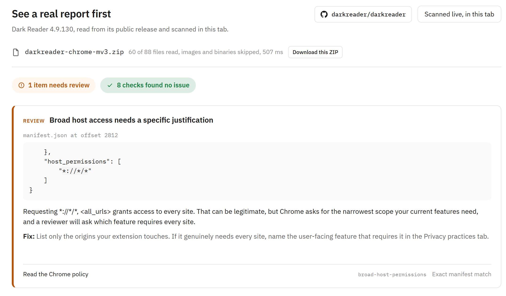

# Extension Preflight



Extension Preflight reads a packaged Chrome extension (the ZIP you upload to the Chrome Web Store) and lists the problems a reviewer is likely to raise. It checks the manifest, the permissions, the content security policy, the packaging and the code, and it shows an excerpt of your own files behind every finding.

I built it because Web Store rejections are often avoidable, and developers only learn about them after waiting for a review. The scanner runs in your browser or in your terminal. Your ZIP is never uploaded.

Try it without installing anything: [extensionpreflight.com](https://extensionpreflight.com). Drop in your ZIP and read the report. The site is a separate interface built on this engine.

## What it checks

There are nine rules. Each one reads the package only. It never runs your code.

| Rule | What it looks for | How it decides |
|---|---|---|
| `manifest-missing` | No `manifest.json` at the top level of the ZIP, for example because it sits inside a folder | ZIP entry listing |
| `manifest-invalid` | A `manifest.json` that does not parse | JSON parse |
| `missing-referenced-file` | A file named in the manifest that the ZIP does not contain (scripts, popup, icons, options page, web accessible resources) | Manifest references against the ZIP listing |
| `broad-host-permissions` | Access to every site, such as `<all_urls>` or `*://*/*`, in host permissions or content script matches | Exact manifest match |
| `redundant-permission` | `activeTab` declared when host permissions already cover every content script site | Exact manifest match |
| `unused-permission` | A permission with no matching `.permission` API call anywhere in the code | Whole-package text search |
| `csp-invalid` | A Manifest V2 style policy string, `unsafe-eval` or `unsafe-inline` in the script sources, or a remote origin in the policy | Policy directive parse |
| `remote-script` | An HTML page that loads a script from another server | HTML script tag parse |
| `obfuscated-code` | A script with a very high density of `\x` and `\u` escapes, which is how obfuscation tools write code | File statistics heuristic |

Findings come in two levels. `High risk` means the problem is likely to block the submission. `Review` means something to confirm.

The scanner also drafts the permission justifications and the remote code answer that the Web Store's Privacy practices tab asks for, based on your manifest. They are starting points to edit, not finished answers.

Before it reads anything, it checks the ZIP itself. It rejects archives that are empty, hold too many files, expand to more than 200 MB, use unsafe paths, or look like a decompression bomb.

## What it does not promise

- A clean scan is not an approval. It cannot see your store listing, your privacy policy, your screenshots or whether the extension works.
- It is not a malware scanner or a security audit.
- It does not run your extension, so it cannot see APIs you reach dynamically.

Two rules are weaker evidence than the rest: `unused-permission` (a text search) and `obfuscated-code` (a statistical guess). Both say so in their output, because either can be wrong in a way an exact manifest match cannot.

## How a rule decides

Every finding carries a `basis` that says how the rule reached it, plus the file, the offset and an excerpt of your own code. If a rule throws on a strange package, the scan keeps going and reports that rule as errored instead of passing it silently. The result also states how many files it opened out of how many were in the ZIP.

## Run it

You need Node.js 20 or newer.

```bash
npm ci
npm run dev
```

That starts the interface locally and prints a URL. Drop a ZIP on the page.

To scan a ZIP from the terminal:

```bash
npm run scan -- path/to/your-extension.zip
```

It prints each finding with its severity, basis, fix and evidence excerpt. You can pass more than one ZIP.

Other commands:

```bash
npm test             # run the tests
npm run typecheck    # TypeScript check
npm run build        # typecheck, then build the interface into dist/
```

## Project layout

```
src/scan/            the engine: unzip, archive guards, run the rules
src/scan/rules/      one file per rule
src/ui/              the reference interface that renders a result
src/worker.ts        runs the scan in a web worker so the page stays responsive
scripts/scan-zip.ts  the terminal scanner
tests/               scan and render tests
```

To add a rule, write a file in `src/scan/rules/` that exports a `Rule` (an `id` and a `run(ctx)` that returns findings), add it to `src/scan/rules/index.ts`, and add tests in `tests/scan.test.ts`.

## Status and contributions

This repository holds the scanner engine, its tests and a reference interface. The hosted site uses this engine, but its interface is a separate codebase, so the two do not match file for file.

I am not accepting pull requests yet. There is no contributor licence agreement in place, and merging a contribution without one would permanently limit how this code can be used. Issues about a false positive or a missed rule are welcome.

## Licence

AGPL-3.0-only. See `LICENSE`.
